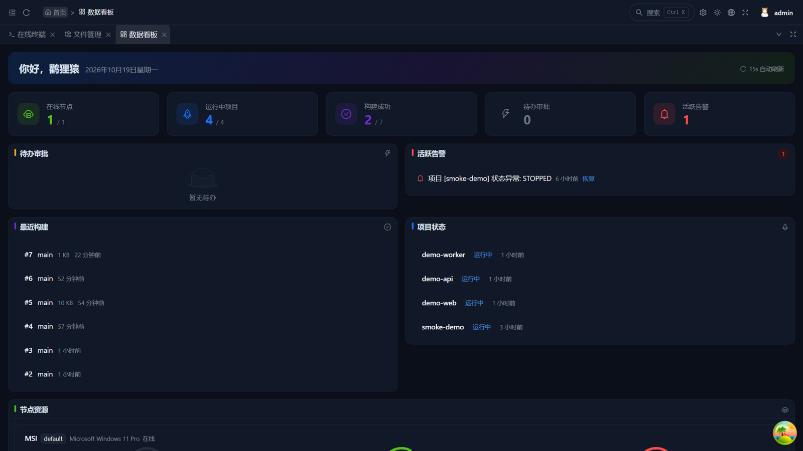
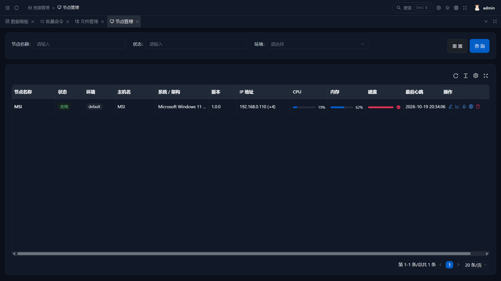
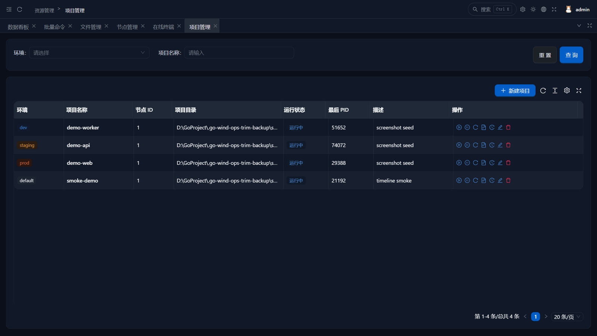
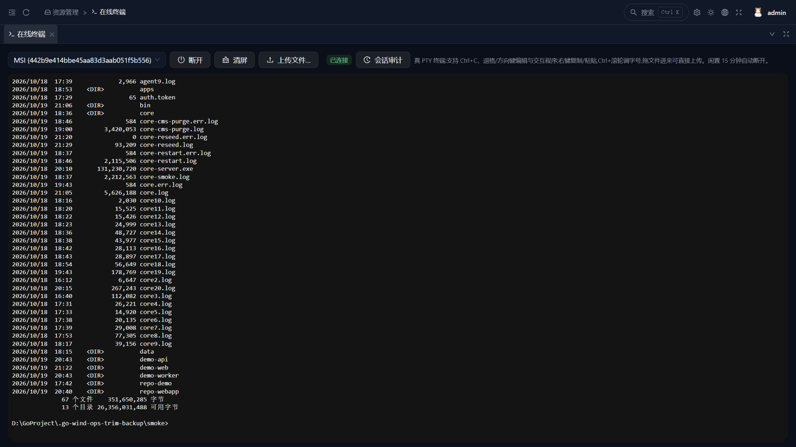
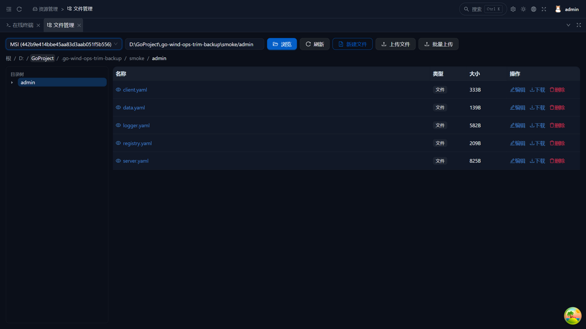
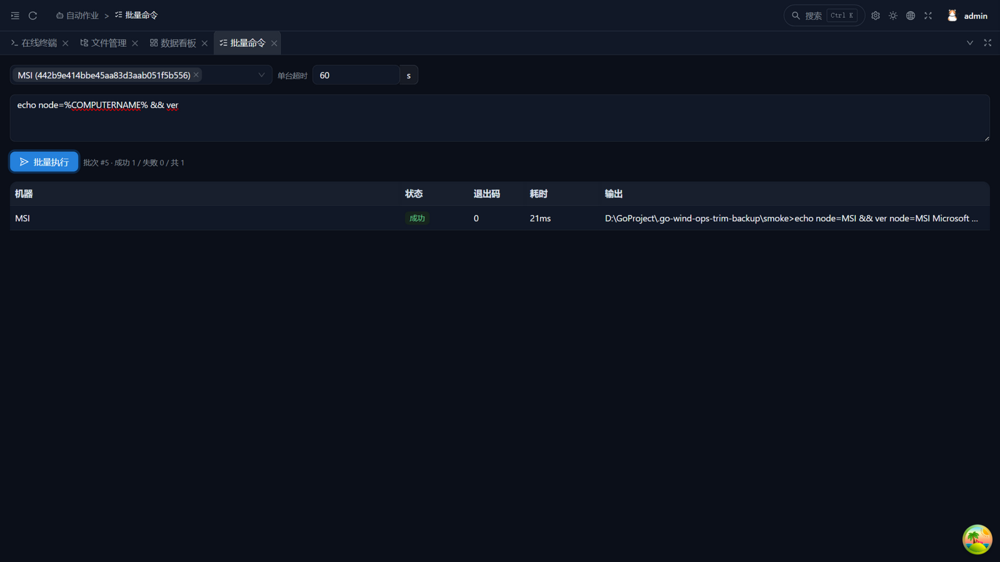
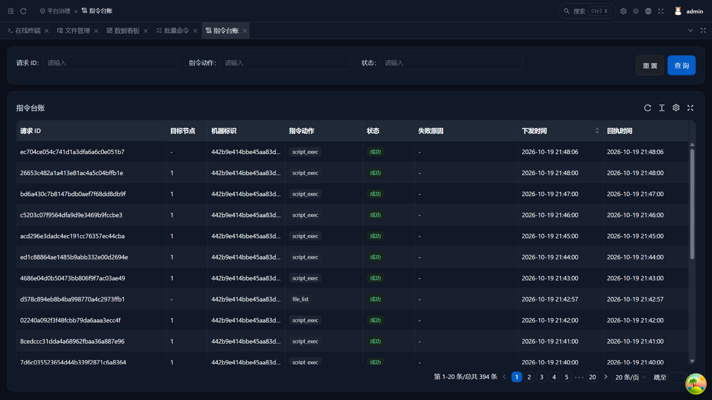
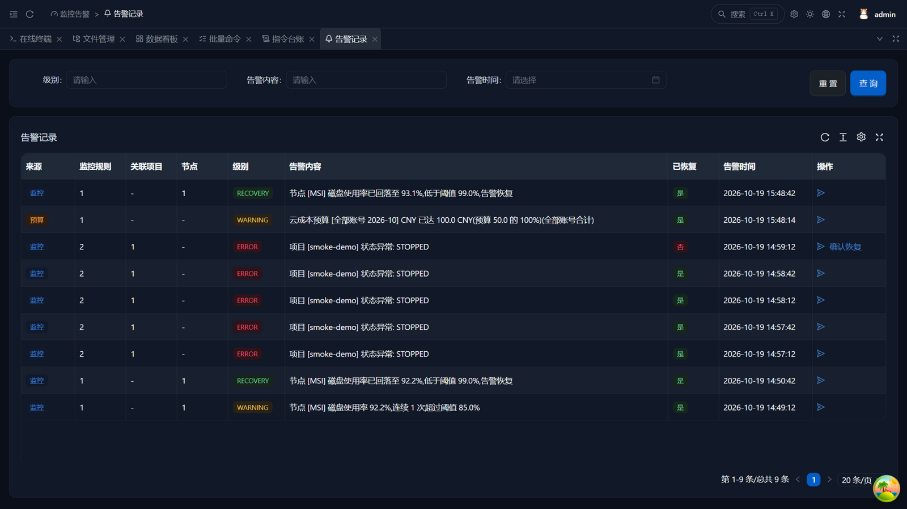
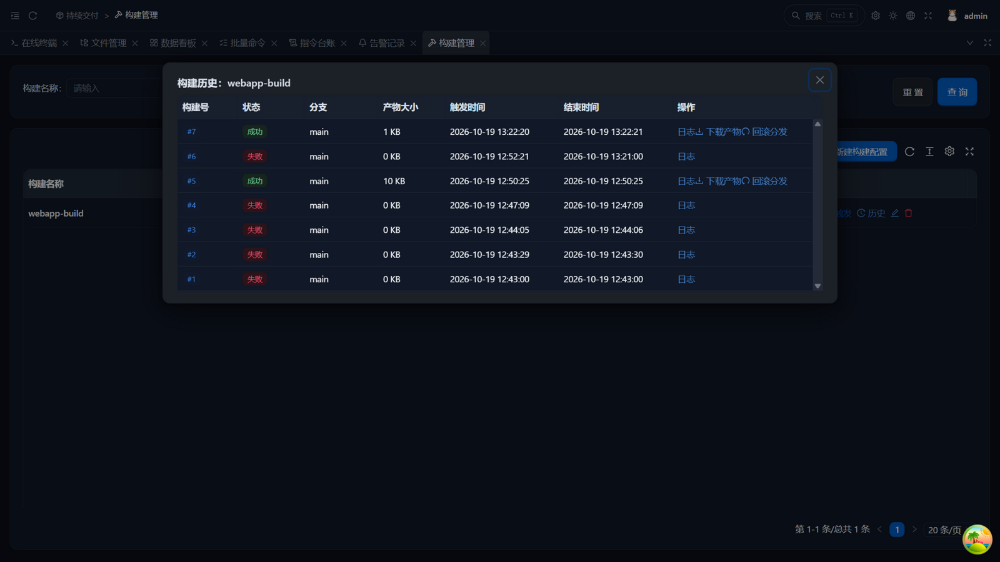

<div align="center">

# GoWind Ops

[](./LICENSE)
[](https://go.dev/)
[](https://go-kratos.dev/)
[](https://react.dev/)

[English](./README.en-US.md) | **中文** | [日本語](./README.ja-JP.md)

</div>

---

GoWind Ops 是一款开箱即用的多节点运维平台（Golang 全栈实现）。系统内置组织权限、审计日志、数据字典等开箱即用的系统能力，聚焦把"管机器、跑项目、发脚本、构建分发"做扎实。

**核心亮点：**

- **四服务架构** — core（领域资源层）/ admin / front（BFF）/ agent（边缘代理），职责单向分层，BFF 不连库
- **MQTT 信令长连接** — agent 纯出站接入 EMQX（无入站端口），`$share` 共享订阅多副本负载均衡，QoS 1 + request_id 幂等对账
- **大文件不过信令** — MinIO 预签名 URL 直传直拉，流式读写 + SHA-256 对账
- **指令全程审计** — 每条指令落台账（PENDING → 终态 / 超时定案），执行结果、时长与失败原因可追溯
- **构建分发闭环** — Git 仓库 → 构建（产物入 MinIO）→ 分发到目标项目目录 / Docker 部署 → 联动重启，流水线编排，全程状态机跟踪
- **Web 终端与文件管理器** — 浏览器直开受管机器 shell（会话全量审计 + 回放），文件浏览/编辑/批量上传走预签名直传
- **可观测与治理** — 监控告警（多渠道通知）、云成本、证书台账、备份、巡检、日志快照、操作审批开箱即用
- **管理前端** — React 19 + Ant Design 6 + ProComponents，登录/权限/审计/字典开箱即用

## 平台预览

| | |
|:---|:---|
| **运维大盘** | **节点管理** |
|  |  |
| **项目管理** | **在线终端** |
|  |  |
| **文件管理器** | **批量命令** |
|  |  |
| **指令台账** | **告警记录** |
|  |  |
| **构建历史** | |
|  | |

## 技术栈

### 后端

| 层级     | 技术                                                                                   | 说明          |
|:-------|:-------------------------------------------------------------------------------------|:------------|
| 语言     | [Go 1.26+](https://go.dev/)                                                          | 高性能编译型语言    |
| 框架     | [go-kratos](https://go-kratos.dev/)                                                  | B站开源微服务框架   |
| 依赖注入   | 手写装配（wiring.go）                                                                  | 无 DI 框架，`make register` 辅助登记 |
| ORM    | [Ent](https://entgo.io/)                                                             | Go 实体框架     |
| 数据库    | [PostgreSQL](https://www.postgresql.org/) / [MySQL](https://www.mysql.com/)          | 关系型数据库      |
| 缓存/队列  | [Redis](https://redis.io/) + [Asynq](https://github.com/hibiken/asynq)               | 缓存与异步任务     |
| 对象存储   | [MinIO](https://min.io/)                                                             | 兼容 S3 的对象存储，预签名 URL 签发 |
| 信令     | [MQTT](https://mqtt.org/)（[EMQX](https://www.emqx.io/)）                              | agent 准入/心跳/指令，QoS 1 + JSON |
| 服务注册   | [Etcd](https://etcd.io/)                                                             | 服务发现（agent 例外：纯出站不注册） |
| 链路追踪   | [Jaeger](https://www.jaegertracing.io/) + [OpenTelemetry](https://opentelemetry.io/) | 分布式可观测      |
| API 定义 | [Protobuf](https://protobuf.dev/) + [buf.build](https://buf.build/)                  | 接口契约优先      |
| 鉴权     | kratos-authn（JWT）/ kratos-authz（Casbin / OPA）                                        | 策略驱动鉴权      |

### 管理前端

| 技术                                            | 说明         |
|:----------------------------------------------|:-----------|
| [React 19](https://react.dev/)                | 渐进式前端框架    |
| [TypeScript](https://www.typescriptlang.org/) | 类型安全       |
| [Ant Design 6](https://ant.design/)           | 企业级 UI 组件库 |
| [ProComponents](https://procomponents.ant.design/) | 企业级中后台组件 |
| [Vite 6](https://vite.dev/)                   | 构建工具（dev :18999） |

## 核心功能

### 节点与项目

| 功能    | 说明                                      |
|:------|:----------------------------------------|
| 节点管理  | agent 机器指纹准入（TOFU 首连注册、未认证自动重试）、30s 心跳上报指标、在线状态、改名/标签/环境标记、CPU/内存/磁盘趋势图、下发 ping 指令 |
| 项目管理  | 项目 = 节点 + 目录 + 启动/停止命令；生命周期操作 START/STOP/RESTART/STATUS，agent 侧授权目录校验（`AGENT_ALLOWED_DIRS`）+ pid 文件管理；项目变更时间线（分发记录 + 告警聚合） |
| 指令台账  | 全部指令审计落库（回执结果/退出码/时长/失败原因），超时自动定案 FAILED |
| 运行日志  | 进程输出落盘 `<项目目录>/.ops-project.log`；WebSocket 实时 tail（增量拉取，GBK 保真——Windows 控制台中文不乱码）、尾部查看与清空 |

### 终端与文件

| 功能    | 说明                                      |
|:------|:----------------------------------------|
| Web 终端 | 浏览器直开受管机器 shell（xterm.js，WS↔MQTT 桥接）；自动重连/剪贴板/字号缩放/清屏；会话输入输出全量审计落库，只读回放字节级保真 |
| 文件管理器 | 目录树 + 面包屑浏览、在线编辑/新建/删除、拖拽上传；选中机器自动进入默认工作目录；大文件走 MinIO 预签名 URL 直传直拉 |
| 批量命令 | 多台机器即席执行同一条命令，逐机状态/退出码/耗时/输出实时矩阵，结果留档批次记录 |
| 批量上传 | 同一批文件发到多台机器同一目录——文件只 PUT 一次，各目标机分别拉取落盘，省 N-1 倍上传带宽 |

### 脚本与构建分发

| 功能    | 说明                                          |
|:------|:--------------------------------------------|
| 脚本管理  | 脚本 CRUD（内容 ≤256KB），远程执行：内容经 MQTT 下发、临时文件按平台 shell 执行、输出/退出码/时长落台账、超时杀进程树；多节点批量执行（批次详情含逐节点结果矩阵） |
| 源仓库管理 | HTTPS Git / 本地路径，密码 AES-GCM 加密落库、回显脱敏       |
| 构建    | 构建配置 + 异步触发（构建号自增、并发去重、中断定案），产物入 MinIO `artifacts` 桶；构建日志实时 tail；产物版本保留策略与回滚分发 |
| 分发    | 产物分发到目标项目目录（zip 解包防 zip slip、clearOld 可选、分发后联动重启/启动），多目标逐记录状态机跟踪；支持分批灰度发布（每批 N 台，前批全部成功才投下一批，任一失败后续批置 SKIPPED）；DOCKER 部署类型（镜像 tag 支持 `{buildNo}` 占位，agent 侧 pull → 替换容器 → run -d） |
| 构建流水线 | BUILD / SCRIPT / DISTRIBUTION 三类步骤有序编排，失败即中止、未执行标 SKIPPED，运行日志增量 tail |
| 定时任务  | 构建/脚本 cron 表达式调度（CAS 锚点去重，首见落锚不补跑） |
| 配置中心  | 配置模板按环境管理，`{{env}}/{{node.*}}/{{project.*}}/{{date}}` 占位符渲染下发，下发记录终态对账 |

### 可观测与治理

| 功能    | 说明                                      |
|:------|:----------------------------------------|
| 监控告警  | 四类监控目标：项目存活 / 节点指标阈值（CPU/内存/磁盘）/ 节点失联 / 进程守护（指定进程消失即告警）；连续 N 周期防抖、恢复自动 resolve 并落 RECOVERY 记录；项目异常自动重启 |
| 通知渠道 | webhook / 钉钉 / 飞书 / 企业微信 / 邮件多渠道管理，告警逐渠道外呼并落投递台账，投递结果可查 |
| 证书台账  | TLS 直连探测回填签发者/有效期，到期告警 + 续期后自动恢复 |
| 备份任务  | 目录 zip 打包直传 MinIO `backups` 桶，保留策略自动清理超额备份；cron 定时 + 手动触发，备份包预签名下载 |
| 巡检报告  | 一键聚合（节点在线/资源水位/项目运行态/未恢复告警/到期证书）生成 JSON 快照，明细表渲染 + 导出 |
| 日志快照 | 项目日志尾部落库，跨项目关键字检索返回命中摘要；支持定时采集（`LOG_SNAPSHOT_INTERVAL_MINUTES`） |
| 运维大盘 | 节点/项目/构建/告警概览 + 节点资源仪表网格 |
| 操作审批 | 分发/脚本等敏感操作先建审批单，审批通过自动下发 |

### 云管理

| 功能    | 说明                                      |
|:------|:----------------------------------------|
| 多云账号 | 阿里云 / 腾讯云 / 华为云 / 亚马逊 AK/SK 台账（AES-GCM 加密落库、回显脱敏），签名直连厂商 API 在线校验有效性 |
| 资源盘点 | 全地域云实例同步（阿里 ECS / 腾讯 CVM / AWS EC2），与 agent 节点 IP 自动对账标记匹配关系 |
| 成本台账 | 账号×月份成本录入 / CSV 批量导入 / 月度趋势图，多币种并列展示 |
| 账单拉取 | 厂商账单 API 直拉月度总额（阿里 BSS / 腾讯计费 / 华为云 BSS / AWS CE），一键入台账 |
| 预算与突增 | 月度预算阈值 + 环比近 3 月均值突增检测，超限触发告警通知，支持手动"立即检查" |

### 平台化

| 功能    | 说明                                      |
|:------|:----------------------------------------|
| OpenAPI | API Key 认证（明文仅创建时展示一次，库存 SHA-256）+ 构建/分发/流水线触发端点 + Git webhook（GitHub/GitLab/Gitea 通用 ref 解析、按分支过滤） |
| 插件指令  | agent `plugins/` 目录脚本映射自定义 action（按扩展名选解释器、超时杀树），前端清单查看 + 执行 |
| Agent 升级 | 浏览器预签名直传新二进制 → agent 下载自替换 → 接力脚本原参重启（真机验证 31MB 全链路） |
| 环境标签  | 节点/项目 `env` 标签（default/dev/staging/prod），列表着色 + 服务端筛选 |

### 系统与运维（基座继承）

| 功能           | 说明                                    |
|:-------------|:--------------------------------------|
| 认证与会话        | 账号密码登录（AES-GCM 密文传输）+ JWT，可选 MFA 二次验证、OIDC 企业单点登录、图形验证码、登录策略管控 |
| 组织与权限        | 用户/角色/菜单/部门/岗位/租户管理，接口权限同步 + 按钮级权限管控，权限分组 |
| 审计体系        | 登录 / 操作 / API 调用 / 数据访问 / 权限变更 / 策略评估六类审计日志全程留痕 |
| 字典与多语言        | 数据字典（类型/条目）、语言管理；管理界面中英双语、暗色主题、多标签工作台 + `Ctrl+K` 快捷搜索 |

## 项目结构

```
go-wind-ops/
├── backend/                        # 后端服务
│   ├── api/                        # Protobuf API 定义 & 生成代码
│   │   ├── protos/                 # .proto 源文件（ops 业务域 + 基座继承域）
│   │   └── gen/                    # 生成代码 (Go / TypeScript / OpenAPI)，不手改
│   ├── app/
│   │   ├── admin/service/          # 管理后台 BFF (REST :18600，gRPC → core，不连库)
│   │   ├── front/service/          # 前台 BFF (REST :18700，gRPC → core，不连库)
│   │   ├── core/service/           # 领域资源层 (Ent schema/仓储/业务逻辑 + MQTT 控制端 + Asynq worker)
│   │   └── agent/service/          # 边缘代理 (纯 MQTT 出站；无库/无服务发现/无 REST)
│   ├── pkg/                        # 公共包 (signal/topic/serviceid/oss/filetransfer/鉴权中间件...)
│   └── scripts/                    # 部署脚本 (Docker 等)
└── frontend/
    └── admin/                      # 管理前端 (React 19 + Ant Design 6 + ProComponents + Vite 6)
```

## 快速开始

### 环境要求

- Go 1.26+
- Docker & Docker Compose
- Node.js 20+ & pnpm
- buf / protoc 工具链（改 proto 时需要，`cd backend && make init` 一键安装）

### 1. 启动依赖服务

```bash
cd backend
docker compose -f docker-compose.libs.yaml up -d   # PG/Redis/MinIO/etcd/EMQX/Jaeger
```

### 2. 启动后端服务

```bash
cd backend
go build -o bin/core ./app/core/service/cmd/server && ./bin/core -c app/core/service/configs
go build -o bin/agent ./app/agent/service/cmd/server && ./bin/agent -c app/agent/service/configs
```

agent 首次启动会在工作目录生成 `auth.token` 并经 MQTT 向 core 注册（TOFU，未认证前每 5 秒重试），随后每 30 秒心跳上报指标。受管机器上运行 agent 前需配置授权目录（环境变量 `AGENT_ALLOWED_DIRS`，平台路径列表分隔符分隔），项目目录必须在授权目录内，否则 agent 拒绝执行。

### 3. 启动管理前端

```bash
cd frontend/admin
pnpm install
pnpm dev        # http://localhost:18999，代理 /admin → 127.0.0.1:18600
```

默认账号 `admin / admin`（验证码开发环境可设 `ADMIN_CAPTCHA_DISABLED=true` 跳过；登录密码需按前端约定 AES-GCM 加密，见 `backend/tools/pass-enc`）。

### 常用命令

```bash
cd backend

# 生成 Ent ORM 代码
make ent

# 生成 Protobuf API Go 代码
make api

# 生成管理前端 TypeScript 客户端
cd api && buf generate --template buf.admin.typescript.gen.yaml

# 一键生成全部代码 (ent + api + openapi)
make gen

# 构建所有服务
make build

# 运行测试
make test
```

> 管理端 REST 接口速览（节点/项目/脚本/仓库/构建/分发/台账全部端点）见 [backend/README.md](./backend/README.md)；后端开发规范与架构细节见 [backend/AGENTS.md](./backend/AGENTS.md)。

## 开发路线

> 实现口径与技术决策详见 [ROADMAP.md](./ROADMAP.md)（Phase 1-10 全部完成）。

**已完成：**

- [x] 基座落地：四服务拆分（core/admin/front/agent）、系统业务域精简、MQTT 信令与 MinIO 预签名传输基础设施、EMQX broker 级认证 + ops 域 RBAC 播种
- [x] 核心四域：节点（准入/心跳指标/趋势图）、项目（生命周期 + 授权目录校验）、脚本（远程执行 + 多节点批量执行）、指令台账（审计落库/超时定案）
- [x] 构建分发闭环：源仓库（凭据加密）→ 构建（并发去重/日志实时 tail/产物保留策略/回滚分发）→ 分发（多目标/分批灰度发布/防 zip slip/联动重启/Docker 部署）→ 流水线（三类步骤编排）
- [x] 终端与文件：Web 终端（自动重连/剪贴板/会话审计回放）、文件管理器（目录树/在线编辑/拖拽上传/大文件预签名）、批量命令与批量上传、项目日志 WebSocket 实时 tail（GBK 保真）
- [x] 可观测与治理：监控告警（项目存活/节点阈值/节点失联/进程守护 + 多渠道通知 + 投递台账）、云成本全套（账号/盘点/台账/账单/预算突增）、证书台账、备份任务、巡检报告、日志快照检索、运维大盘、操作审批、变更时间线
- [x] 平台化：OpenAPI（API Key + Git webhook）、插件化指令、Agent 远程升级（真机 31MB 自替换验证）、环境标签隔离、配置中心（占位符渲染下发）、cron 定时调度
- [x] 管理前端：基座（登录/权限/审计/字典）+ 全部业务页 + i18n 缺键扫描门禁（`pnpm check:i18n`）+ typecheck 清零

**进行中 / 规划：**

- [ ] 准入加固：EMQX ACL 全量覆盖、STS 短令牌轮换
- [ ] 环境标签 v2：分发目标与项目 env 的跨资源级联校验
- [ ] 指令台账关联 project_id（时间线聚合纳入指令）
- [ ] 日志快照核心侧切 content_b64（GBK 场景无损）

## 参与贡献

我们欢迎各种形式的贡献，包括但不限于：

- 提交 [Issue](../../issues) 报告 Bug 或提出功能建议
- 提交 [Pull Request](../../pulls) 修复问题或添加新功能
- 完善文档
- 分享使用经验

提交前请阅读 [CONTRIBUTING.md](./CONTRIBUTING.md) 了解开发约定与门禁。

## 开源许可

本项目基于 [MIT License](./LICENSE) 开源。
